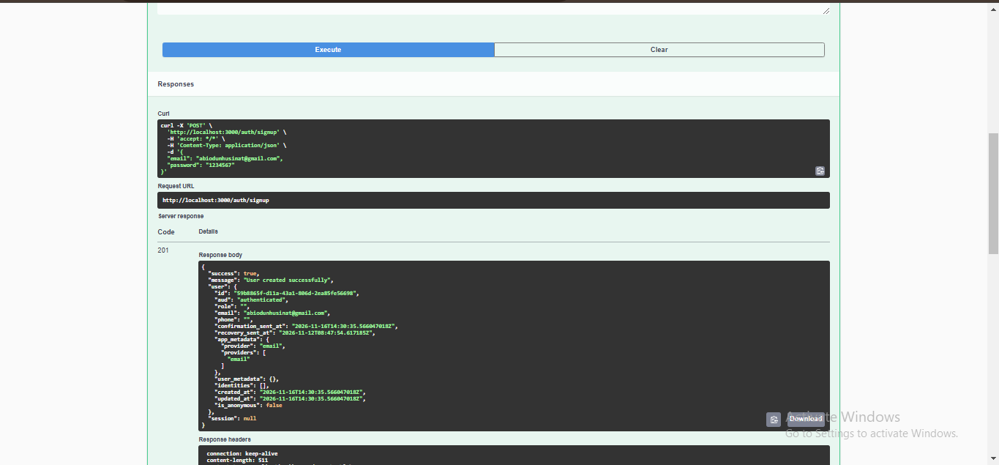
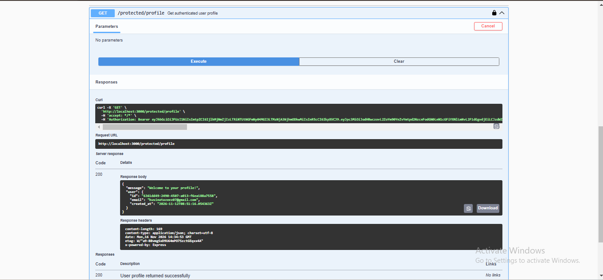

# FlyRank Week 4 — Authentication API

A RESTful authentication API built with **Node.js, Express.js, and Supabase Auth** as part of the FlyRank AI Backend Engineering Internship.

The API supports user registration, login, logout, JWT-based authentication, and protected routes. It also includes interactive API documentation powered by Swagger UI.

## Features

- User registration with email and password
- User login with Supabase authentication
- Access and refresh token generation
- Protected routes using JWT verification
- Reusable authentication middleware
- User logout
- Public API endpoint
- Interactive API documentation with Swagger UI

## Tech Stack

- Node.js
- Express.js
- Supabase Auth
- JSON Web Tokens (JWT)
- Swagger UI / OpenAPI 3.0
- dotenv

## Project Structure

```text
week-4-auth-login-protect/
├── middleware/
│   └── authMiddleware.js
├── routes/
│   ├── authRoutes.js
│   └── protectedRoutes.js
├── .env.example
├── .gitignore
├── index.js
├── supabase.js
├── openapi.json
├── package.json
└── package-lock.json
```

## Getting Started

### Prerequisites

- Node.js installed
- npm installed
- A Supabase account and project

### 1. Clone the repository

```bash
git clone YOUR_GITHUB_REPOSITORY_URL
cd week-4-auth-login-protect
```

### 2. Install dependencies

```bash
npm install
```

### 3. Configure environment variables

Create a `.env` file in the project root by copying `.env.example`.

```bash
cp .env.example .env
```

On Windows, you can also create the file manually.

Add your own Supabase project URL and publishable key:

```env
SUPABASE_URL=your_supabase_project_url
SUPABASE_KEY=your_supabase_publishable_key
PORT=3000
```

**Important:** Never commit your `.env` file or expose your Supabase secrets.

### 4. Start the development server

```bash
npm run dev
```

The API will run at:

`http://localhost:3000`

### 5. Open Swagger documentation

Visit:

`http://localhost:3000/docs`

Use the **Authorize** button to enter a valid Supabase access token when testing protected endpoints. Enter the token without the `Bearer ` prefix.

## API Reference

| Method | Endpoint | Description | Authentication |
|---|---|---|---|
| POST | `/auth/signup` | Register a new user | No |
| POST | `/auth/login` | Authenticate a user and receive tokens | No |
| POST | `/auth/logout` | Log out the current user | Yes |
| GET | `/protected/profile` | Retrieve authenticated user profile | Yes |
| GET | `/protected/dashboard` | Access the protected dashboard | Yes |
| GET | `/public/info` | Retrieve public information | No |

## Authentication

Protected endpoints require a valid Supabase access token in the request header:

```http
Authorization: Bearer YOUR_ACCESS_TOKEN
```

The authentication middleware verifies the token using Supabase Auth before allowing access to protected resources.

## API Documentation

Interactive API documentation is available through Swagger UI at `/docs` when the server is running.

### POST Request — User Authentication



### GET Request — Protected Profile




## Author

**Husinat Azeez Abiodun**

GitHub: [github.com/Husinat](https://github.com/Husinat)

LinkedIn: [linkedin.com/in/husinat-azeez](https://linkedin.com/in/husinat-azeez)

---

Developed as part of the **FlyRank AI Backend Engineering Internship — Week 4 (BE-03)**.